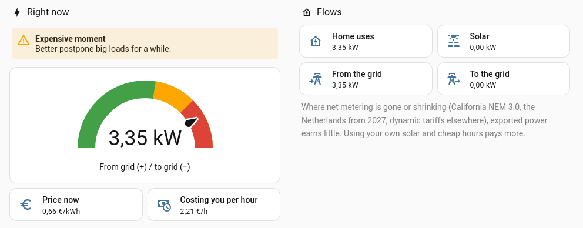

# Energy Now: is power cheap right now? (Home Assistant)

A clean Home Assistant dashboard that answers one question at a glance: **is electricity cheap right now, and what is
my home costing me per hour?**

- **Cheap / normal / expensive / negative** price compared to today's average, with a simple tip
- **Cost per hour right now** (net power × price)
- Import, export, solar and home usage, plus the last 24 hours
- **Core Home Assistant only**: no HACS, no custom cards. You edit 4 lines.
- Versions for **€, $, £ and A$**

Works with P1/DSMR, HomeWizard, Enphase Envoy, Shelly EM, Emporia Vue, IoTaWatt, SolarEdge or Powerwall for power,
and Tibber, Octopus Agile, Nord Pool, Amber, EnergyZero or any other "price now" sensor.

## Install (± 10 minutes)
1. Make sure `configuration.yaml` has `homeassistant: packages: !include_dir_named packages`.
2. Copy the file for your currency (`energy_now_EUR.yaml`, `_USD`, `_GBP` or `_AUD`) to `/config/packages/`.
3. Edit the four lines under `EDIT THIS` (your net power sensor and price sensor; solar and average price are optional).
4. Check configuration and restart Home Assistant.
5. Create a new dashboard and paste `dashboard.yaml` in the raw configuration editor.

Full step-by-step guide and FAQ: [GUIDE.md](GUIDE.md).

## Full version
A paid full version is in the works: daily and monthly costs, the cheapest hours today and tomorrow, a standby-power
finder and a battery/solar savings calculator. Want an e-mail when it's ready? Get the free download (and say "yes")
here: **https://payhip.com/b/aomDO**

## Feedback
Found a bug, or is your meter or price provider not working? Please open an issue.

Tested with Home Assistant 2026.11. Version 0.1. MIT licensed.
